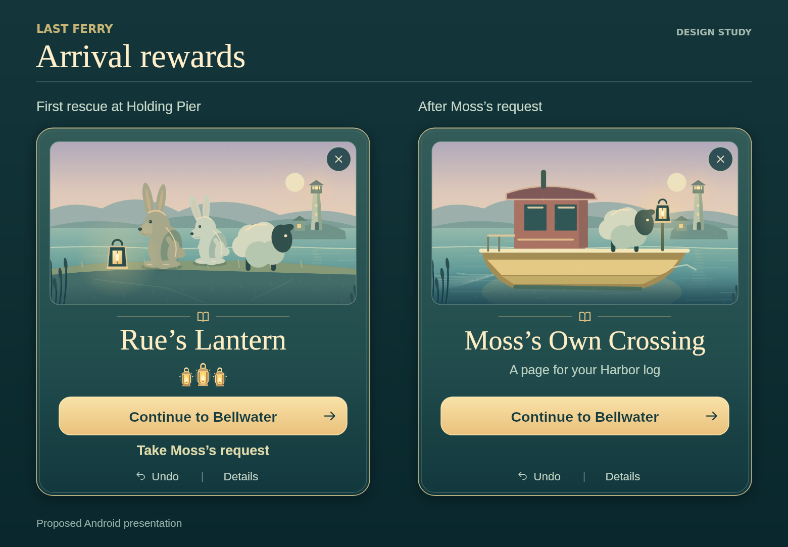

# JOURNEY_REWARDS_01 · Keep the captain in the Journey

Deliver the next private Android update over v0.1.4 and its matching player-facing web build. The owner played Moss’s request, reached the reward, then had to navigate Home to carry on. They want a live game with earned revisits, a continuous Journey and a more inviting reward screen with much less text. The current evidence head is `3b939da815c2de79271fa197e06945ab7f339744`; the v0.1.4 APK was built from `b768be9ea0659240226aec957bc567c20772f343`. [Current Android frames and handoff](reviews/harbor-log/android-REVIEW.md)

## One tap from the keepsake to the next chapter

The first rescue currently saves Bellwater before opening Moss’s request. The request result routes its primary button to Home. Keep the first handoff. Change the second one: taking **Continue to Bellwater** on Moss’s earned page accepts the page and the eligible best, then opens the saved **Another bell** scene. Its existing story control takes the helm at Bellwater, turn zero. This is the actual Journey. A later request or ordinary revisit should resume the captain's actual saved scene or cove, including a pending supper. After a completed Journey, return directly to the Harbor log. Match the action label to the real destination. Home remains freely available when deliberately chosen.

If the rescue succeeds but misses the request, retain the rescue, offer **Try Moss’s request again** and an easy way to resume the Journey. Preserve a stronger best and award each keepsake once. Closing the unaccepted result, opening Details or using terminal Undo keeps the result provisional. After acceptance, duplicate taps, retry and cold restart must preserve both the reward and the right story checkpoint. Follow the existing storage-failure behavior and surface a real save failure. [Current request routing](src/main.ts) · [Qualifying rescue and keepsake records](src/game/moss-request.ts)

## Make the live game a Journey with a Harbor log

Remove the unrestricted Practice mode from the complete player experience, including this playtest APK and normal production web builds. Home starts or continues the Journey. The Harbor log shows earned keepsakes and offers **Revisit** on rescued Journey coves. A future destination may be shown as upcoming. Players discover it through the story. Apply this consistently to Home, credits, replay results, the crossing menu, unscored-cove labels and direct `?cove=` links. A fresh production profile given an unreached-cove link must open a legitimate Journey entry without changing progress. Existing developer routes can be available in an explicitly enabled QA build. A URL parameter alone must not turn on the test picker in the live game.

Use the saved Journey as the source for story progression and keep older Practice bests and keepsakes readable. A revisit improves the eligible record independently of chapter progress. The standalone First Crossing is outside the twelve-chapter count. Preserve its saved best and allow captains who already earned that record to revisit it from the log. New captains see the twelve Journey coves. [Current Harbor log](src/campaign/harbor-log.ts)

## Make the reward the first thing the player sees

The study uses the game’s current Harbor painter and original result-lantern artwork. It shows the intended hierarchy at the first detour. Adapt the composition and destination to the device and saved Journey.

- **First Holding Pier rescue.** Show the existing warm illustration of Rue’s lantern with Pip, Rue and Moss at Harbor, and the title **Rue’s Lantern**. Keep the earned lanterns visible in a compact treatment. Give **Continue to Bellwater** one unmistakable primary button. Offer **Take Moss’s request** as an immediately visible secondary choice, with his wish clear from the choice or a short request line at the helm. Both choices accept the first rescue.
- **First qualifying Moss rescue.** Give the solo-ferry illustration the most space on the card. Title it **Moss’s Own Crossing**. Use one destination button. Put action count, Undo count, lantern comparison and explanations in **Details**. Let the lantern catch the light or the illustrated page settle into its frame as the existing arrival cue plays. The destination button is active immediately. Reduced Motion should show the full reward immediately. If the player qualifies on the original rescue, keep both earned entries discoverable without stacking two blocking celebrations. On repeats show a simple rescue result and the correct way onward.
- **Ordinary results.** Retain the original lanterns and rescued figurines where they tell the story. An unscored rescue can celebrate its passengers. Provide accessible names, a quiet Undo/close path before acceptance, and a way to inspect details. Keep a genuine save-error message visible if needed. Avoid repeating the cove name, the reward and the same save instructions in several places.

The v0.1.4 narrow frame clips the bottom utility row. At 320 × 740 portrait and 780 × 320 landscape, keep the illustration recognizable and the primary action in the safe area, visible at first paint without scrolling. A side-by-side composition in short landscape is fine. Use the existing Harbor paintings, palette and art assets. [First-arrival baseline](reviews/harbor-log/android-first-arrival-choice.png) · [Moss baseline](reviews/harbor-log/android-moss-arrival.png)

## Play the route the owner reported

On the normal installed build, begin at the first Journey rescue, **Take Moss’s request**, deliver the rabbits first, return for Moss, accept his reward, open *Another bell* directly, and reach Bellwater turn zero. Record the uninterrupted passage from the final delivery to the next chapter, including the actual primary tap. Verify on a separate saved captain that taking a request later resumes their own chapter, then cover missed and repeated requests, Undo before acceptance and a cold start after acceptance. Check a fresh player cannot launch the finale or find an all-coves picker, earned revisits work from the log, and completed players can still revisit after credits. Confirm both keepsakes, lantern bests and original saves survive the v0.1.4 update.

Hand back the APK, version/code, SHA-256, source commit, concise verification, and matched portrait and short-landscape reward frames. Identify which checks ran on Android and which used the browser. The release-bundle rehearsal remains queued until the player-facing change has had a playtest.
