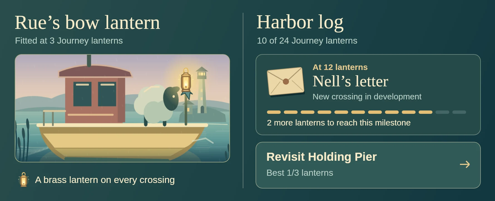

# Lantern rewards · Rue’s bow lantern and Nell’s letter

Give a captain a reason to choose one more crossing. The first reward should travel with them. The second should tell them exactly what there is to look forward to. This is a separate, playable web prototype based on v0.1.6, on `lantern-rewards-prototype`. The Android release rehearsal proceeds on `m1-first-crossing`. The shared feedback group continues to play private Site version 31.

The illustration uses the existing Harbor artwork. The boat’s illustrated navigation light predates this reward. Give the new fitting its own recognizable brass case on the playable models. The [interactive director’s study](reviews/lantern-rewards/direction/preview.html) uses example captains to demonstrate award timing and the letter; use it as a behavioral reference. Open the downloaded file in a browser.

## What to deliver

1. **At 3 Journey lanterns, fit Rue’s bow lantern.** Show a small brass-and-glass running light with a warm center attached to the bow of the actual playable ferry. Give the fitting a silhouette you can recognize while the boat moves. It travels with both ferry sizes. A perfect first rescue earns it in time for Bellwater, or for Moss’s replay if the captain accepts that invitation. Someone earning one lantern per cove will earn it on their third accepted rescue. Existing captains with enough lanterns see it the next time they take the helm. Rue’s original illustrated page and her handheld lantern at Harbor retain their story meaning. The fitted lamp is a gift inspired by hers. Keep the default camera, the boarding gate, the passengers and the depth markers clear.
2. **At 12, open a real letter from Nell in the Harbor log.** Preview a sealed envelope below 12. When the captain reaches 12, they can open it immediately or return to it later. Use a simple letter in Nell’s own voice. The first prototype delivers the letter. Her playable tow is the follow-up design. In this preview, put a brief note outside her words that the tow is still in development. That distinction matters if an existing captain starts the build with 12 or more. Keep the unlock available on a prior save.
3. **Give the next trip a purpose.** From Home, the Harbor log is the stable place to see the total, the next reward and an earned cove worth revisiting. At a scored arrival the existing result still says, for example, **1/3 lanterns** for this rescue. If there is room, use one quiet, optional preview beside the existing log or Details affordance. Commit progress on the same deliberate acceptance as the current game. Opening Details, closing or undoing a delivery should never grant a permanent reward. Keep Moss’s invitation, his earned page and the main onward action legible.

**Example before the first unlock.** “2/3 toward Rue’s bow lantern.” After acceptance at the milestone, “Rue’s bow lantern is fitted.” Show it on the next crossing without interrupting the helm or asking the player to claim it.

**Example with a reason to replay.** “10/12 toward Nell’s letter · 2 more lanterns.” A rescued cove such as “Revisit Holding Pier · Best 1/3” lets the player earn the missing two. Link only to a currently accessible revisit and show its real best. If there is no eligible improvement, the existing onward journey remains useful. On a single screen, label the denominators so a captain can tell the rescue score, the next reward threshold and the lifetime total apart. Avoid adding three progress bars to the arrival card.

**Nell’s letter**

> Captain,
>
> There’s an empty skiff at Driftwood Yard, and the tide is on the turn. Could you bring her round? I’ve left the towline coiled by the slip.
>
> — Nell

## Which lanterns count

Use the sum of each rated Journey cove’s current-revision accepted personal best, read through the existing mastery store. Eight Journey coves award up to three each, for 24 available. A better trip from 1/3 to 3/3 adds two. A tie, a worse result, or a keepsake alone adds zero. Include legitimate older bests even after a new Journey starts. Chapter availability still comes from the Journey checkpoint. The separate legacy First Crossing best belongs to its own entry. The final four unscored rescues count toward the story. Neither they nor the standalone cove contribute to the 24. Keep the stored records as the source of truth, including the existing behavior when persistent saving is unavailable. Do not require players to re-earn accepted lanterns during the upgrade. [Mastery records](src/game/mastery.ts) · [Journey registry](src/campaign/registry.ts) · [Earned revisit rules](src/campaign/revisit.ts)

## Beyond the prototype

The next design question is whether towing an empty skiff at Driftwood creates an interesting choice about when to pick it up. Prototype that puzzle separately and verify it under the production rules before presenting it as a playable reward. The planned capstone, **The Harbor Lights**, is a bell answered by lights around the route and a signed chart for the log. It requires all 12 Journey rescues and all 24 lanterns, in either order. Supper and credits continue to belong to every captain who finishes. For now, a fully rated captain can see 24/24 and their real story progress.

## Evidence for the next playtest

- Play the first rescue through the normal controls and show an actual threshold crossing. At the same regular phone camera, capture the ferry before and after the fitting and during a short sail, in portrait and short landscape. Check sightlines with passengers aboard and on the larger ferry. The reference artwork gives direction, while normal gameplay determines size and placement.
- Show 10→12 after a genuine improvement, open Nell’s letter, revisit after reload, and show that a lower-scoring rescue keeps an earlier best. A prepared profile may establish the starting total. Exercise a returning v0.1.6 save, Undo or dismissal before acceptance, and the existing failed-save behavior. Let reduced-motion and screen-reader users perceive the same reward. Preserve ordinary campaign access on a fresh or restarted Journey.
- Give the owner a separately identifiable prototype browser build that can run alongside the feedback version with independent saves. Use the existing dependencies, focused regression tests and the production build. Report which routes were played on a device or in emulation. The current feedback site and Android package stay available during this test.

[Current v0.1.6 baseline and phone evidence](reviews/moss-invitation/REVIEW.md)
