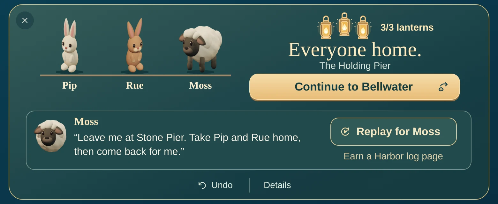

# Moss’s invitation at Holding Pier

The captain’s v0.1.5 phone screenshot shows Pip, Rue and Moss on the left, with “Pip and Rue first. Moss waits at Stone Pier.” separated from the “Take Moss’s request” action on the right. All three neighbors are already home. A player can reasonably read the small line as a description of the trip they just finished. Before a tap, the choice should answer what they will play, what Moss wants, and what they can earn. The owner liked the rest of the arrival.

The study uses the original rescued figurines, close portrait, lanterns and controls. It shows an example three-lantern result at 780 × 320. It is a layout reference for the developer.

## One invitation, spoken by Moss

Keep the rescued group or Rue’s illustration, the existing warm primary Journey button and the quiet utilities. In the existing offer area, group Moss’s name or portrait, his words, the book reward and the secondary button. Remove the detached italic caption. Let the text wrap at a readable size. Give the replay button the same visual language as the other controls, with less emphasis than the onward button.

- **Moss** — “Leave me at Stone Pier. Take Pip and Rue home, then come back for me.”
- Book icon with the short caption **Earn a Harbor log page**.
- Secondary action **Replay Holding Pier for Moss**, or **Replay for Moss** where Holding Pier is already clearly named. Keep **Continue to Bellwater** as the primary action in the first-chapter example. Use the real saved destination in other situations.

Apply this to both arrivals that actually offer the request, Rue’s first keepsake and the ordinary “Everyone home.” card in the owner’s screenshot. Use the same wish on Moss’s existing Harbor log entry and at the helm. The rabbits can come home together or separately. On a miss, let the short retry line explain that Moss needs to be at Stone Pier when *each* rabbit reaches Harbor. Taking the invitation uses the existing replay and acceptance flow. Continuing now leaves the request available from the log.

## Show what this trip earned

On a scored arrival, keep the game’s lantern artwork and make the current count readable at a glance, e.g. **3/3 lanterns** or **1/3 lanterns**, beside it. Include it on the Moss keepsake card where v0.1.5 hides it in Details. Keep the page title and illustration prominent. Derive the count from the current run. The stronger historical best belongs in Details. Use the existing unscored treatment for an unrated arrival. Let a screen reader announce the count once. Keep the qualifying rule, lantern targets, Undo, saves, earned revisits and campaign routing intact.

## Phone handoff

Use the v0.1.5 production flow as the baseline. Play both choices at Holding Pier. Show the screenshot’s ordinary offer and Rue’s first offer at phone size. Show that continuing directly still reaches Bellwater, and that accepting the invitation, delivering the rabbits first and returning for Moss can earn the page and lead straight into the saved Journey. Include a real result where this run earns 1/3 and the best remains 3/3. In the short recording, hold on the **offer before tapping** and on the **earned page with its visible lantern count**. The previous recording begins after the offer has passed.

Check the invitation, onward action and live lantern count on narrow portrait and short landscape with the normal safe areas and text size. Keep button focus, touch targets and the collapsible Details control usable. Deliver a matching phone-browser build and the next in-place Android playtest update using the project's established workflow. Verify an existing v0.1.5 captain’s progress survives. Use the existing draft PR. Game direction will review the offer before proceeding with release preparation.

[Current Android evidence](reviews/journey-rewards/android-REVIEW.md) · [Arrival layout](src/ui/arrival.ts) · [Exact request rules](src/game/moss-request.ts)
