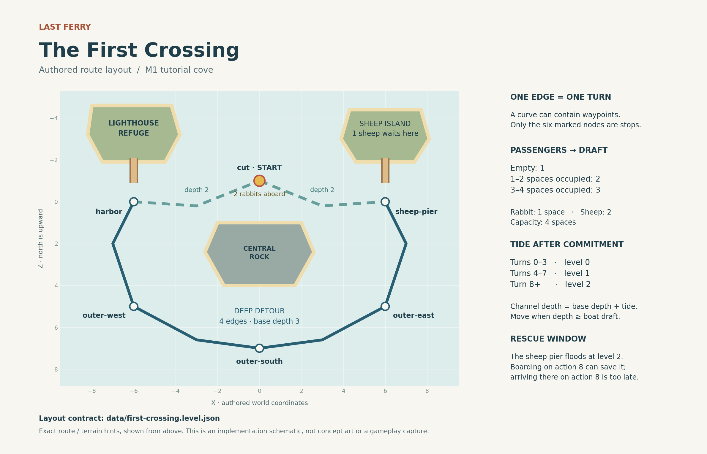

# First Crossing: authored M1 cove

**Scope:** one small tutorial cove, six stopping nodes, two rabbits, one sheep, two scheduled tide rises, and one safe harbor. This document and `data/first-crossing.level.json` specify a buildable first slice. The included script validates a reference design; no playable game or rendered scene has been tested.

This is an introduction with several valid approaches. Do not describe the seven-action route as a hard puzzle, promise a ten-minute session, or manufacture replay systems around it. Its purpose is to make the boat's load, the route depths, and the rising tide understandable and appealing.

## Starting situation

The ferry starts in the water at `cut`, carrying `rabbit-1` and `rabbit-2`. They use two slots and give the boat draft 2. `sheep-1`, using two slots, waits at the low `sheep-pier`. All three must eventually be unloaded at `harbor-pier`, beside the lighthouse refuge.

The player can go directly to the sheep, or head to the harbor first. Collecting the sheep fills the boat, increasing draft from 2 to 3. At tide 0, that closes the shallow return route while the deep outer route remains available. Waiting for the first rise is also valid; the design does not pretend the detour is mandatory.

## Routes



This schematic explains the authored layout. Use the separate concept images for the final visual treatment.

All edges are bidirectional and each committed edge traversal costs one action. Edge waypoints affect presentation and clearance, not turn cost.

| Route | Nodes in order | Edges | Base depth | Full boat at tide 0 |
| --- | --- | ---: | ---: | --- |
| Shallow cut | `harbor` → `cut` → `sheep-pier` | 2 | 2 | Blocked |
| Deep outer detour | `harbor` → `outer-west` → `outer-south` → `outer-east` → `sheep-pier` | 4 | 3 | Safe |

The first tide rise is after turn 4, raising shallow routes to depth 3. The second is after turn 8, raising them to depth 4 and flooding the sheep pier. The harbor stays dry. The exact order is **action → turn increment → tide → flood failure → win**; see [GAMEPLAY_RULES.md](GAMEPLAY_RULES.md).

## World layout and mesh exclusions

Positions use **world XZ units**, with north toward negative Z. The renderer is 3D, but the gameplay topology is an authored graph. Logical boat positions are water basins outside island and pier meshes.

| Node ID | X | Z | Base basin depth | Pier |
| --- | ---: | ---: | ---: | --- |
| `harbor` | -6 | 0 | 3 | `harbor-pier` |
| `cut` | 0 | -1 | 3 | None |
| `sheep-pier` | 6 | 0 | 3 | `sheep-pier` |
| `outer-east` | 6 | 5 | 3 | None |
| `outer-south` | 0 | 7 | 3 | None |
| `outer-west` | -6 | 5 | 3 | None |

The intermediate waypoints make the outer route curve around the central rock while the shallow cut passes north of it:

| Edge ID | Ordered waypoints `[X, Z]` | Base depth |
| --- | --- | ---: |
| `harbor-cut` | `[-6, 0]`, `[-3, 0.2]`, `[0, -1]` | 2 |
| `cut-sheep` | `[0, -1]`, `[3, 0.2]`, `[6, 0]` | 2 |
| `sheep-outer-east` | `[6, 0]`, `[7, 2]`, `[6, 5]` | 3 |
| `outer-east-south` | `[6, 5]`, `[3, 6.6]`, `[0, 7]` | 3 |
| `outer-south-west` | `[0, 7]`, `[-3, 6.6]`, `[-6, 5]` | 3 |
| `outer-west-harbor` | `[-6, 5]`, `[-7, 2]`, `[-6, 0]` | 3 |

Reverse the waypoint order when traversing an edge in the opposite direction. The authoring contract is the polyline. If smoothing it into a curve, keep the actual hull inside the verified clearance corridor and independently verify that the curve cannot cut through a rock, island, or pier. A visual bend is not an extra stopping node.

The JSON includes three exact land exclusion polygons: `lighthouse-island`, `sheep-island`, and `central-rock`. Keep island mesh footprints within those polygons. Keep lighthouse and other substantial structures within their island footprint. Do not place attractive extra rocks in the channel. Decorative overhangs, hull shape, wake geometry, and camera occlusion still need visual review.

| Pier | Land anchor `[X, Z]` | External pier tip `[X, Z]` | Boat basin `[X, Z]` | Deck elevation |
| --- | --- | --- | --- | ---: |
| `harbor-pier` | `[-6, -2.1]` | `[-6, -0.9]` | `[-6, 0]` | 3 |
| `sheep-pier` | `[6, -2.1]` | `[6, -0.9]` | `[6, 0]` | 2 |

Each pier is a 0.6-unit-wide rectangle from its land anchor to its external tip. Its land anchor intentionally overlaps its own island to connect the jetty; its tip and the boat basin are outside land. Do not center the ferry on the pier or island. The tip is 0.9 units from the logical boat center. During implementation, orient and size the hull so its boarding side meets a credible small gangway or step from that tip; check the actual reach and clearance at runtime. Board/unload by animating passengers across that connection; this visual movement is not a separate gameplay action. The point-node model does not validate a docking animation.

The JSON's `referenceBoatRadius` of **0.3 units is a small point-radius proxy**, not the visible ferry's dimensions or a maximum collision hull. The reference routes require at least **0.45 units of centerline clearance** from land and pier footprints. The validator checks every polyline segment against the exclusion polygons and rejects unmarked route crossings; its measured minimum for this layout is **0.9 units**. These checks establish a clear reference path only. They do not establish full collision safety for a larger, oriented, or animated hull.

**Size the visible ferry for the passengers, not for that proxy.** A 0.6-unit-wide ferry would be too small to communicate three aboard animals in a full-cove mobile view. At the target 844×390 viewport, adjust the camera and visible ferry proportions until the sheep and both rabbits are readable. Check the resulting actual hull footprint along every turn and at both piers, including yaw changes and boarding reach. If a readable hull cannot fit, revise the relevant layout dimensions and revalidate them; do not claim the point-radius report already proves the fit.

Initial water Y is 0. The suggested presentation scale is `waterY = tideLevel × 0.18`; pier/plateau surfaces are at `elevation × 0.18`. If representing channel beds, their initial floor height is `-baseDepth × 0.18`. Gameplay uses integer levels, never sampled mesh heights. At the flood threshold, rendering can avoid coincident-surface artifacts without changing the logical threshold. Harbor and central rock elevations are 3; the sheep island and pier elevation is 2.

The suggested orthographic camera is `[12, 32, 20]`, targeting `[0, 0, 1.2]`, approximately 55° above the horizontal. The suggested vertical span is 18 world units. These are a starting frame, not fixed acceptance criteria: adjust framing, zoom, and azimuth to the viewport and the [art direction](ART_DIRECTION.md), keeping all relevant nodes, passengers, routes, and tide information readable. Never move the authoritative nodes to compensate for poor camera framing without rechecking routes and exclusions.

## Witness action sequences

These are reproducible examples from the exact starting state. They are alternatives, not additional modes or content requirements. Board/Unload selections are committed together as one action.

### A. Collect everyone and take the deep detour — seven actions

Source: `data/replays/full-boat-detour.json`.

| Turn after action | Action | Boat node | Load / draft | Tide | Result |
| --- | --- | --- | --- | ---: | --- |
| 0 | Start | `cut` | 2 / 2 | 0 | Two rabbits aboard; sheep waiting |
| 1 | Move to sheep | `sheep-pier` | 2 / 2 | 0 | Pier dry |
| 2 | Board sheep | `sheep-pier` | 4 / 3 | 0 | Shallow cut is blocked; outer route safe |
| 3 | Move to outer east | `outer-east` | 4 / 3 | 0 | Deep route |
| 4 | Move to outer south | `outer-south` | 4 / 3 | 1 | First rise follows this move |
| 5 | Move to outer west | `outer-west` | 4 / 3 | 1 | Deep route |
| 6 | Move to harbor | `harbor` | 4 / 3 | 1 | Still aboard; not yet won |
| 7 | Unload both rabbits and sheep | `harbor` | 0 / 1 | 1 | Win |

### B. Wait for the cut to deepen — seven actions

Source: `data/replays/wait-for-tide.json`.

1. Move `cut` → `sheep-pier`.
2. Board `sheep-1`.
3. Wait; the cut is still too shallow.
4. Wait; the first rise now opens the cut.
5. Move to `cut`.
6. Move to `harbor`.
7. Unload all three passengers; win.

Waiting is a real one-turn action. It is not a clock that runs while the player considers the board.

### C. Deliver the rabbits first — eight actions

Source: `data/replays/harbor-first.json`.

1. Move `cut` → `harbor`.
2. Unload `rabbit-1` and `rabbit-2`.
3. Move to `cut`.
4. Move to `sheep-pier`; the first rise follows arrival.
5. Board `sheep-1`.
6. Move to `cut`.
7. Move to `harbor`.
8. Unload the sheep; the second rise floods its empty former pier, then the puzzle is won.

## Boundary examples to reproduce in the real game

| Case | Setup and attempt | Required result |
| --- | --- | --- |
| Blocked full boat | Move to sheep; board sheep; try moving to `cut` at turn 2. | Reject: depth 2 is below draft 3. State and history unchanged; outer-east remains reachable. |
| Cannot use an impending rise early | After the previous boarding, Wait once to turn 3; try moving to `cut`. | Reject. A further valid Wait reaches turn 4 and opens the route for the next action. |
| Last safe boarding | Move to sheep on turn 1; Wait six times to turn 7; board sheep. | Boarding commits, then the turn-8 rise floods the now-empty pier. Boat and passengers are safe. |
| Arrival is not boarding | Wait seven times at `cut`; move to sheep as action 8. | Move is legal, then the still-waiting sheep is stranded; loss. |
| Low-pier unloading can fail | Collect sheep by turn 2; Wait five times to turn 7; unload one rabbit at the sheep pier. | Unload commits, then the turn-8 rise strands that rabbit; loss. Preview must show this. |
| No deadline once everyone is aboard | Use last-safe boarding, then Wait repeatedly. | Tide stays 2 and play continues. Return to harbor and unload normally. |
| Undo first rise | Undo a valid action that produced turn 4. | Restore turn 3, tide 0, previous boat/passenger locations, and previous outcome. |
| Undo flood loss | From turn 7 at sheep pier, Wait into the flood; Undo; board sheep instead. | Undo restores the entire turn-7 state; alternate boarding is safe. |
| Undo win | Unload the last passengers at harbor, finish the presentation, then Undo. | Restore the passengers aboard and status `playing`; repeating Unload reproduces the same win. |

The replay directory also contains `missed-sheep-deadline.json` and `last-safe-boarding.json`. Their expected outcomes are intentionally `lost` and `playing`, respectively. They are boundary fixtures, not failed solution attempts.

## Level data schema

The JSON is a small authored contract, not a general-purpose content engine. Its `$schemaDescription` is explanatory text, not a URL to an external JSON Schema. Stable IDs use lowercase letters, digits, and hyphens.

| Field | Structure and meaning |
| --- | --- |
| `schemaVersion`, `kind`, `id`, `title` | Version 1, `last-ferry-authored-level`, stable level ID, display title. |
| `provenance` | Marks this as an authored reference design and points to these rule documents. |
| `rules.capacity` | Maximum occupied passenger slots, 4. |
| `rules.draftBands` | Ordered inclusive `maxLoad` thresholds with their `draft` values. |
| `rules.tide.initialLevel`, `rules.tide.rises` | Initial level 0; ordered `{ afterTurn, level }` rises at 4→1 and 8→2. No additional rises. |
| `rules.actionCost`, `depthFormula`, `pierDryWhen`, `failureRule` | One-turn action contract and human-readable formulas; do not dynamically evaluate strings as code. |
| `world` | XZ convention, water-height scale, explicitly limited reference-radius/centerline-clearance hints, adjustable suggested camera, and island polygons/elevations. |
| `nodes[]` | `{ id, positionXZ, baseDepth, pierId? }`. The node position is the boat's stopping point. |
| `edges[]` | `{ id, nodes: [a, b], baseDepth, bidirectional: true, waypointsXZ }`. Waypoints begin at `a` and end at `b`. |
| `piers[]` | IDs linking node and island; elevation; external tip and land anchor; width; delivery marker. |
| `passengers[]` | `{ id, species, slots }`. Two rabbits at one slot each; one sheep at two slots. |
| `start` | Boat node, aboard IDs, and a waiting-ID array for every pier. |
| `objective` | Delivery pier ID and required passenger IDs. The objective's delivery ID is authoritative and agrees with the pier's delivery marker. |
| `validation` | Search horizon and witness paths. These are tooling metadata, not gameplay limits. |

Replay JSON uses `schemaVersion`, `levelId`, `id`, `purpose`, an ordered `actions` array, and an `expected` object. `expected` is a partial final-state assertion: every listed field must match exactly. A replay begins at the authored starting state and contains only committed gameplay actions. Invalid attempts, previews, Undo, and Restart are checked separately by the script.

## Finite state search and its limits

Run:

```bash
node tools/verify-design.mjs --write-report
```

Node 20 or newer is sufficient; no packages, network, browser, or game build are needed. `--json` prints the full report; `--help` describes the command. The executable resolves input paths relative to its own repository location, so it also works when invoked by an absolute path from another directory.

The reference breadth-first search enumerates adjacent moves, every nonempty available passenger subset for Board/Unload, and Wait. It rejects actions through the reference reducer and checks passenger conservation, capacity, safe basins, and terminal states. The search horizon is **12 actions**, a validation bound rather than an in-game deadline. It finds a shortest winning sequence of **7 actions** and processes **502 canonical reachable states** for the shipped data.

The turn counter and an arbitrary Undo history are not literally finite. For reachability, the search uses a finite gameplay equivalence: retain exact turn phases 0–7, then map every turn at or after 8 to phase 8. No later rise or deadline exists, so two states with identical boat/passenger locations, tide, and outcome have the same legal future after that point. Actual replay turn counts remain unchanged; Undo histories and UI-only states are excluded from search.

The generated report records all checks, input SHA-256 hashes, witness timing traces, the bounded search result, and its limitations. It is deterministic for identical inputs and contains no generated timestamp. It proves only the reported properties of the authored reference model. It does not prove that the game has been implemented, that its controls or animations work, that its meshes avoid the routes, or that the tutorial is enjoyable. Build and test those independently; do not import the reference validator as the production engine.
