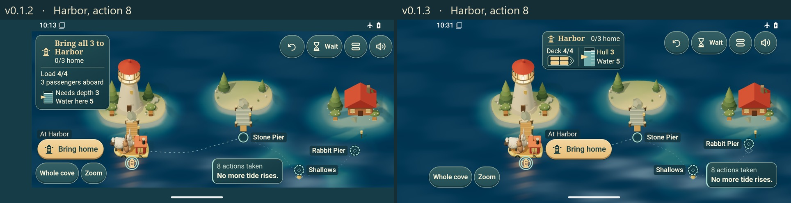

# Android cove view · v0.1.3

The private phone update uses version code 3, the same debug signer, the same `com.lastferry.playtest` application ID and the existing local HTTPS origin. Install over v0.1.2 and choose **Update**. [Install and reproduce](INSTALL.md) · [Tested APK source, SHA-256 and independent web-asset comparison](package.json)

**Tested source** `faa3880c13835e1f9d566760bba8cf2b4d5c1e87`. **APK SHA-256** `e2d080d1d5106fdb8c57533ba7e0cf268d82876e04125991302ab68f591ba4e9` (3,985,947 bytes). The accepted v0.1.2 package starts with its genuine two-lantern Holding Pier best and Bellwater checkpoint from the earlier installed playthrough. We checked its original data before replacement, installed this APK with `adb install -r`, then force-stopped and cold-launched it offline. The Journey record, mastery best, Sound, Motion, Tips and original-byte backup all matched. Practice showed two lanterns and Continue reopened Bellwater at action zero. The test emulator retained its original install time and Android UID. [Update and cold-start receipt](device/upgrade.json) · [Earned record on v0.1.3](device/updated-practice.png) · [Origin of the save](../android-playtest/play/README.md)

## What changed at the helm

The Android Activity gives the WebView the whole window and reports the system bars, cutout, gestures and keyboard in physical pixels. The game converts them once to CSS coordinates for its controls, dialog placement and map targets. Native recovery controls receive the same safe bounds. Android owns the clock, gesture handle and camera cutout. The sea draws behind the system UI. [Android edge-to-edge guidance](https://developer.android.com/develop/ui/views/layout/edge-to-edge) · [Display cutout guidance](https://developer.android.com/develop/ui/views/layout/display-cutout)

Play starts with an authored cove composition. The ferry travels through that view, including when the player has dragged the sea or changed the zoom. Inspecting a visible dock, boarding, waiting and Undo preserve the frame. **Whole cove** and **Back to boat** deliberately change it. Keyboard focus can reveal an offscreen landing. Story and final homecoming retain their own framing. [Short and long camera measurements](camera/README.md)

At Harbor the new deck shows four occupied slots for Pip, Rue and Moss. The depth gauge separates the hull pointer at 3 from the waterline at 5. The lighthouse shows zero of three home until delivery. A free tap on the sign reveals the exact readings and the three names. The tide sign still shows the action count and next relevant change. At Rush Landing, water 3 supports boarding Rowan with Button (required depth 3). With Thistle aboard the same boarding needs 4 and its local control explains the block. [Portrait · Button](web/390x844/rush-button.png) · [Portrait · Thistle](web/390x844/rush-thistle.png) · [Landscape · Button](web/780x320/rush-button.png) · [Landscape · Thistle](web/780x320/rush-thistle.png)

## Installed comparison

Both Harbor frames come from the offline Android app at action eight, with all four spaces occupied, immediately before bringing everyone home. The matched pair uses the same free **Whole cove → Back to boat** input at the berth, on the same display with the same cutout and system-bar settings. The Android clock is visible in the uncropped captures. [v0.1.2 Harbor](device/before-harbor-back-to-boat.png) · [v0.1.3 Harbor](device/after-harbor-back-to-boat.png)

On the 2048×955 display the updated WebView starts at (0, 0) and covers the whole app window. The previous left, top and bottom gutters were 100.0%, 98.0% and 98.4% host teal respectively. After the update, all three regions contained 0.0% of that color. The installed rescue also exercised the rabbit chooser, Undo across the tide, recovery to the same turn and final delivery. [Full-frame pixel counts](device/edges.json) · [Boarding at Rabbit Pier](device/after-boarding-chooser.png) · [Arrival](device/after-holding-arrival.png)

The [36-second installed recording](device/pan-sail-undo.mp4) shows the captain changing zoom, dragging on open water, tapping Shallows, sailing, docking and pressing Undo. During the short crossing and a separate longer Stone Pier → Harbor crossing, the fixed lighthouse point moved **0 CSS pixels** from the visible destination’s inspection through docking and Undo. The recording uses normal game motion and has no audio track. [Device measurements and reproduction](device/README.md) · [Projection samples](device/camera.json)

## Verification

The ordinary production web build and TypeScript check passed. Fresh Home-to-rescue runs at 1440×900 and 780×320 completed Holding Pier and undid the tide-crossing boarding. Four additional minified touch-browser checks exercised the instruments, disclosure and both Rush Landing outcomes in portrait and short landscape. The archive audit verified the same signer as v0.1.2, zero requested permissions and all thirteen web files against the independent production output. The catalog retained all 83 families. [Desktop rescue](web/home-1440x900/result.json) · [Short-landscape rescue](web/home-780x320/result.json) · [Instrument checks](web/INSTRUMENTS.md) · [Package receipt](package.json)

The installed tests used Android 16, WebView 133.0.6943.137, gesture navigation and an emulated display cutout. The owner’s physical cutout, touch feel, TalkBack speech and frame pacing await a handset retest. The private Site remains on version 29.

The window and WebView matched in portrait (955×2048) and both landscape directions (2048×955). At DPR 2.5 the WebView rounded the long canvas layout dimension up by two physical pixels, which the window clips at its edge. No additional display band was reserved outside the app window on this emulator. Nine gameplay controls stayed inside the reported safe area in each orientation. The open transfer chooser, arrival card, fullscreen menu and system Back also passed. After an induced WebView renderer exit the native retry controls stayed in bounds and returned to Home with the original save. [Insets, fullscreen and recovery](device/rotation.json)

The final serial unit run passed **778/778 tests across 66 files**, including the depth-gauge and dock hit-area regressions. All six production-browser receipts matched the signed APK’s JS and CSS. [Verification summary](checks.json)

## First-run findings

On the original v0.1.2 emulator capture the landscape window was 2048×955 while the game began at (165, 60) and ended at (2048, 875). The owner’s 2048×955 phone had different gutters. Its inset values were not supplied. The emulator recreates the native padding defect with a configured cutout. [Original measurements](device/before.json)

The first v3 candidate filled the window, but the Sound button extended four CSS pixels into the portrait Back gesture band. The menu’s declared width and flex basis disagreed. Matching both icon widths and aligning the toolbar to its safe right edge corrected this. In short-landscape Far Shore play the dock panel also covered a Harbor map target or the Board control in certain arrangements. The placement check now considers fixed controls, selectable markers and the two dock-panel orientations. [Original toolbar measurements](device/first-run/first-portrait-tools.json) · [Far Shore hit test](web/pilot/harbor-hit-obstructed.json)

The first web driver tapped through two opening shots inside the story’s input guard and stayed on “Next.” The repeated run waited for each shot and used the normal input cadence. One intermediate package audit also detected a web/APK mismatch while a placement edit was underway. The delivery audit compares every bundled web file with an independent build from the final source.
