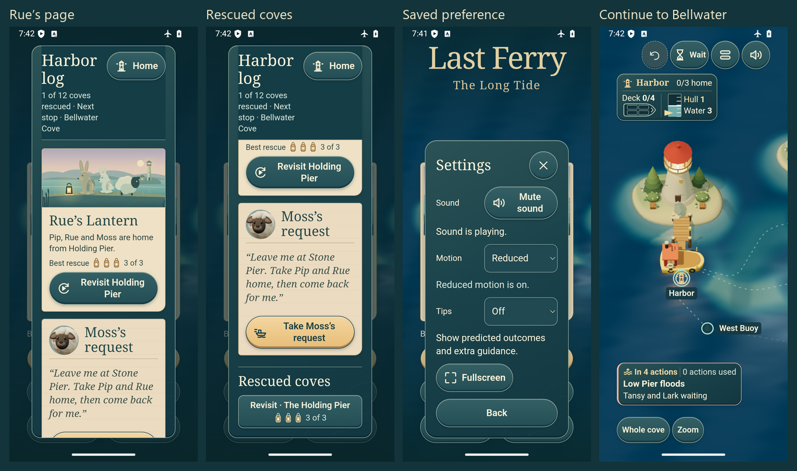

# Android release rehearsal

The rehearsal packages the reviewed v0.1.6 game under the launcher label **Last Ferry Rehearsal**. Android gives `com.lastferry.playtest.rehearsal` its own installation and save directory. The regular phone playtest uses `com.lastferry.playtest`.

| Source | Commit |
| --- | --- |
| Game and its 13 production web files | [86a4e7b](https://github.com/EDLMGit/Lastferry/commit/86a4e7b7c2b993630444c696068c1789f13a582d) |
| Rehearsal commission | [04d7e63](../../NEXT_TASK_ANDROID_RELEASE_REHEARSAL.md) |
| Android build configuration for both rehearsal versions | [afad00a](https://github.com/EDLMGit/Lastferry/commit/afad00ae0e047ea45e4eab2ac5d1d09bc50cd8e3) |

## Captain’s offline rescue

The code 7 installation opened at Home with **Play** and zero rescued coves. The captain changed the motion preference to **Reduced**, rescued Pip, Rue and Moss in nine actions, accepted **Rue’s Lantern** with **3/3 lanterns**, and continued into Bellwater Cove on turn zero. [Fresh Home](device-fresh-home.png) · [Rue’s arrival](device-rue-three-lanterns.png) · [Bellwater before the update](device-before-bellwater.png)

The installed code 8 screenshots show the same page in the Harbor log, Holding Pier under **Rescued coves** with three lanterns, and **Reduced motion is on** in Settings. The recorded best is nine actions with zero Undos. [Full Harbor log frame](device-updated-rue-log.png) · [Rescued coves](device-updated-rescued-coves.png) · [Preference](device-updated-preference.png)

Android replaced code 7 with code 8 in place. The installed package retained its app ID and first-install time. After a force-stop and offline cold launch, the captain’s visible Home, Harbor log, best and preference matched the pre-update observations exactly. **Continue** reopened Bellwater with zero actions used. Both release processes had WebView inspection disabled. [Before the update](device-rescue.json) · [Cold restart and resumed chapter](device-update.json) · [Device walk and exact commands](device-REVIEW.md)

The ordinary v0.1.6 playtest shared the emulator. Its own Home still offered **Play** and its Harbor log still showed zero rescued coves after the rehearsal. [Independent playtest save](device-ordinary-after.json)



## What was installed

The private handoff folder is `Last Ferry Android Playtest/rehearsal-afad00a/`. The `.aab` files are signed release bundles. Each accompanying `.apks` archive contains the base APK, English language split and xxhdpi resources selected for the 400 dpi test device. The package receipts give the SHA-256 values for the bundles, sets and individual APKs.

| Private bundle | Version code | SHA-256 |
| --- | ---: | --- |
| `Last-Ferry-rehearsal-7.aab` | [7 · first install](package-7.json) | `f4f3dc82b4de17700b4b542f8a6a4791d30ec30b7d75cba0cbe31a2e76957731` |
| `Last-Ferry-rehearsal-8.aab` | [8 · update](package-8.json) | `2eebe4595c3f97dce600244b4f8ec3d17393a9e089fa40fe7ffae37aa2df3022` |

The local rehearsal certificate signs both AABs and all generated APKs, allowing Android to update the same package in place. Its SHA-256 fingerprint is `1bc1e387899c528e86819aa2a6fb933ebde229ef91d42b05c9734bb2502038d7`. The build reads the test keystore and its password from private files outside the checkout and handoff.

Both AABs passed strict signature verification and bundletool 1.18.3 validation. Their release manifests target API 36 with minimum API 29, request zero permissions and disable debugging, test-only mode, backup and cleartext traffic. The independent production build, both bundles and both sets of APKs matched all 13 files in the original v0.1.6 receipt. The game has its developer global and QA picker compiled out. The default `:app:assembleDebug` check also retained the ordinary v0.1.6 package ID, signer, label and version code. [Debug variant check](playtest-regression.json) · [Device targeting](device-spec.json)

## Choosing the test device

The first install reached fresh Home on the SDK’s AOSP API 36 `userdebug` image. Its WebView 133 provider opened an inspection socket owned by the rehearsal process. The run stopped before any rescue actions. That provider enables inspection on a `userdebug` OS even when the application passes `false`. The replacement was Google’s API 36 Play Store image, revision 7, with build type `user` and `ro.debuggable=0`. [Discarded fixture observation](fixture-userdebug.json) · [Chromium’s debug-build check](https://github.com/chromium/chromium/blob/133.0.6943.137/base/android/java/src/org/chromium/base/BuildInfo.java#L387-L407) · [WebView’s setter](https://github.com/chromium/chromium/blob/133.0.6943.137/android_webview/glue/java/src/com/android/webview/chromium/SharedStatics.java#L110-L118) · [Android emulator system images](https://developer.android.com/studio/run/managing-avds#systemimage)

## Reproduce the local package

Use Node 24, JDK 17, Android SDK Platform 36 with Build Tools 36.0.0, and bundletool 1.18.3. Point `JAVA_HOME`, `ANDROID_HOME` and `BUNDLETOOL` at the local tools. Point `REHEARSAL_KEYSTORE` and `REHEARSAL_PASSWORD_FILE` at the private PKCS12 test keystore and its password file. The script expects alias `last-ferry-local-rehearsal`. Keep both versions on the same local test key. The helper verifies the runtime sources against the pinned commit, checks the AAB signature, validates the bundle, generates a targeted APK set and verifies every split. [Packaging commands and checks](package.py) · [Android bundletool reference](https://developer.android.com/tools/bundletool)

From the repository root, use a checkout containing the review scripts and the pinned Android tree. Set `ANDROID_SERIAL` to the dedicated test device and `$out` to a new private output directory. With the device offline, generate its spec and package the two versions.

```powershell
npm ci
$spec = Join-Path $out 'device-spec.json'
New-Item -ItemType Directory -Force -Path $out | Out-Null
& "$env:JAVA_HOME/bin/java" -jar "$env:BUNDLETOOL" get-device-spec "--device-id=$env:ANDROID_SERIAL" "--output=$spec"
python reviews/android-release-rehearsal/package.py 7 --source afad00a --device-spec $spec --output $out
python reviews/android-release-rehearsal/package.py 8 --source afad00a --device-spec $spec --output $out
```

For the final user-image install, the same commands included `--signed-bundle <path-to-the-original-aab>` and used a new output directory. This preserved each signed AAB byte for byte while producing a new device-targeted APK set.

## What goes to Google Play next

The owner supplies the permanent application ID and provides the upload keystore and its credentials privately. Google Play signs the APKs delivered to testers with the app signing key. The next distribution test is a first install and a higher-version update through the internal track. A separate, uncoached fresh-player observation on the existing v0.1.6 phone build is pending with the owner. [Owner handoff and internal-track plan](../../docs/GOOGLE_PLAY_LAUNCH.md)
