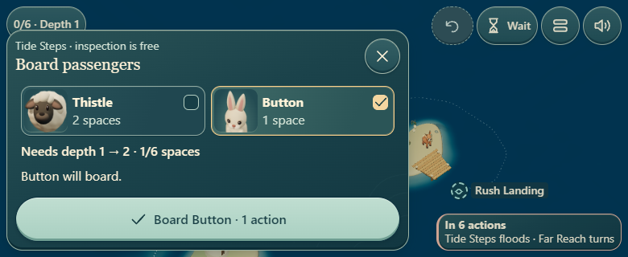

# Far Shore · Practice playtest

At Tide Steps, Thistle and Button are both close enough to bring home. Which one can afford to ride **away** from Harbor with you on the next crossing?

[Play the local Practice build](http://127.0.0.1:5390/?cove=far-shore) · [Local Journey and Practice menu](http://127.0.0.1:5390/)

[Portrait choice](play/390x844/tempting-action.png) · [Free turn-zero forecast](play/390x844/decision-forecast.png) · [Matched native phone frames](play/README.md)

## What changed in play

In the first phone rescue I took Button home, carried Thistle out to Far Bank and let her ashore there. The banner now read “Rush Landing floods in 2 actions.” That was exactly enough time to sail and board Rowan. All four neighbors got home in 14 actions. A decision about the first passenger could be repaired by answering the banner at the last dock. [Prototype immediately after unloading](play/development/390x844/after-staging.png) · [Played route and original forecast](play/development/390x844/run.json)

The final version moves Rush Landing’s flood from action nine to eight. Tide Steps still floods and the current still turns after action six. A player can inspect each waiting passenger’s size and the Rush berth’s load limit from the first turn. Free inspection uses the same tide and draft bands as boarding. With an overweight party at Rush, the dock shows both the required and available depth. The phone framing puts the companions and the far shore in view together.

The inference and its consequence

Rowan takes three spaces. Rush Landing can support four loaded spaces on the last action before it floods. Button and Rowan fit at four. Thistle and Rowan would take five and need depth four. The six-space deck has room for either party. Sending Thistle home first lets Button ride outward, leaving just enough water to board Rowan. Returning to Far Bank after the pickup lets Peat join them. The current brings the group home.

The important commitment happens at the first passenger chooser. Bringing the nearer rabbit home is legal and visibly succeeds. The consequence only shows up after the ferry makes its next outward crossing. Eight Undos let the player revisit that commitment after seeing Rowan’s landing flood.

## Rules and scope

The exhaustive production search found a minimum of **13 actions**. Far Shore uses the unscored Practice result. The eight-cove Journey ends at Ternhaven. Twelve Practice entrances are available on this branch and nine coves have mastery targets. The design reuses the established six-space ferry, three species, current, draft bands and flood rules. A single turning reach makes the passenger choice visible across both banks. [Rules and alternate settings](DESIGN.md) · [Geometry](world.md)

## Release verification

The minified build passed the complete touch rescue in 390×844 portrait with normal motion and 780×320 short landscape with Reduced Motion. Both runs tried the rabbit-first delivery, reached the disabled Board action with four empty spaces, saw Rowan stranded, restored the first choice with eight Undos and completed the rescue in thirteen actions. Terminal Undo and redelivery reproduced the unscored arrival. [Blocked boarding at Rush](play/390x844/rush-with-thistle.png) · [Same turn with the other companion](play/390x844/rush-with-button.png) · [Unscored arrival](play/780x320/arrival.png) · [Browser results](play/browser.json)

[Uninterrupted portrait rescue with runtime audio](play/390x844/arrival.mp4) · [Recording measurements](play/MEDIA.json). At **0:29** the deeper load prevents Rowan from boarding. The player returns to the original choice with Undo at **0:34**. At **1:01** the lighter load reaches the same berth on the same turn. The four neighbors arrive at **1:28**. The 89.53-second recording retains all 1,299 captured frames. The longest pause between visual frames is 3.50 seconds. Live audio continues through the capture stalls.

Node 24.15.0 passed TypeScript, the production build, all 735 unit checks and the 83-family catalog check. The exhaustive proof covered 241 states and 588 legal transitions. A one-unit increase in the Rush berth’s depth restored the opposite first pickup. The initial geometric test exposed a lighthouse overhang, corrected before final capture. The phone evidence uses Chromium touch emulation with software WebGL. Physical Android performance and how readily a fresh player discovers the solution still need a playtest. [Verification](VERIFICATION.md) · [Production proof](proof.json)

Home → Practice offered all twelve coves. At 320×740 and 1440×900, free keyboard inspection returned focus, Restart cleared the turn history, and direct entry preserved the saved Journey, mastery bests and three backup records byte for byte. The desktop run also completed the rescue and returned Home from the unscored arrival. The app update interrupted the initial desktop check. The completed rerun used the same release bundle. [320px observation](continuity/320x740/observed.json) · [Desktop observation](continuity/1440x900/observed.json)

The tested runtime inputs match the submitted source. All 154 matched the capture manifest, including ten files whose staged Git blobs differ only by normalized line endings. The production JS and CSS match the bytes the phone tests received. [Source audit](source-audit.json)

The private Site continues to serve version 25, game `5f28d71566463462b9407e34b0bf236bb05e20c6`. Far Shore is available for local review. [Publication receipt](../lantern-reach-difficulty/deployment-confirmation.json)
