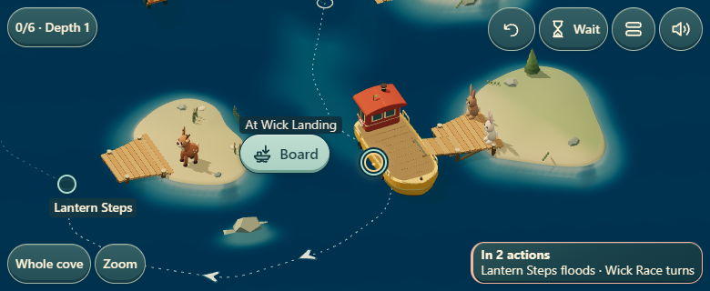

# Lantern Reach · the return to Wick

## Before you move

You're back at Wick Landing with an empty six-space ferry. Tallow and Ember are right beside the boat. The bridge is open. Across Wick Race, Sorbus is still waiting at Lantern Steps. The forecast gives the Steps two actions and Wick six. Boarding both rabbits costs one action, sailing across costs another, and Sorbus boards only after you reach him.

**Do you board the rabbits now, or leave Wick with an empty deck?**

[Portrait view](play/390x844/decision-before.png) · [Open the free forecast](play/780x320/decision-forecast.png) · [Matched before/after frames](play/README.md)

[Play the candidate](http://127.0.0.1:5380/?cove=lantern-reach). The normal entrance starts at turn zero. The situation above is reached through play.

Open the solution and proof

From this turn-six position, boarding either or both rabbits uses one of Sorbus’s last two actions. The game is still playing after boarding. Even sailing straight across on eight reaches the Steps as they flood with Sorbus ashore. Leave empty on seven, take Sorbus on eight, and the same tide change turns the race back toward the rabbits. Wick stays dry until twelve.

The earlier decision made this moment possible. The ferry starts at Wick with two-space Flax aboard. The signal winch floods after action three. Its approach starts at depth two. Taking the shallow approach with Flax lets you open the span, deliver him and return to Wick with all six spaces free. On the outer plan, one rabbit fits with Flax and three-space Sorbus. Both rabbits fill the space reserved for Sorbus.

| Same map, different bridge condition | Minimum actions |
| --- | ---: |
| Normal winch and flood schedule | 13 |
| Permanently closed | 17 |
| Permanently open from the start | 12 |

The search exhausted 3,170 states and 8,618 legal transitions in the normal puzzle. At opening, taking both rabbits still leaves the game playing but excludes every win. With the bridge already open, the same pickup can lead to a 14-action rescue. With that extra action in hand, an empty ferry can also return to Wick one turn earlier and take both rabbits before visiting Sorbus. The bridge changes which pickups are possible. [Complete production proof](proof.json) · [Reproduction and iteration notes](DESIGN.md)

## Why this arrangement survived

The original bridge demonstration secured every passenger on turn two. I tested a six-space relay with eight passenger spaces at Wick. A real thirteen-action rescue needed two visits and a staging stop at Signal. Seven distinct opening loads all matched its minimum. By the time the winning witness opened the bridge, every passenger was already above the flood. That made the winch a delivery convenience. [Playable prototype recipe and production search](development/quay-relay.mjs) · [Opening-load comparison](development/quay-relay.json) · [Actual touch rescue](development/relay-ui.json) · [Prototype manifest](development/relay-choice.png)

The retained arrangement puts a deer at a second occupied landing across the turning current. Ternhaven asks where a group should wait for a later retrieval. Drowned Orchard asks what must already be across when the ferry's last outward window closes. Here the relationship is between which passenger load can reach a working winch, how many spaces must remain available if it closes, and which shore can safely wait through a reversal. The six-space ferry gives the player a real third spot beside Flax and Sorbus. A four-space ferry would remove that plan.

## Engineering and playtest record

The production build, TypeScript and all 714 unit checks across 61 files passed on Node 24.15.0. The unit command was `npm run test:unit -- --maxWorkers=1`. Vite retained the existing bundle-size advisory. The asset inventory passed with the same 83 IDs. The seventeen focused world cases cover the six-space hull, swing, both docking orientations, supported transfers and shore groups. The initial layout clipped three dock approaches and part of the short-landscape rescue view. [Corrections and final geometry results](world.md)

Both minified phone runs passed. Each reproduced the turn-six mistake, actual turn-eight loss, both Undos, alternative rescue on eight, delivery, terminal Undo and redelivery. Landscape additionally rescued the complete roster via the closed outer route. The actual interface showed no lantern award. [Action records, phone frames and source](play/README.md) · [Original preflight failures](play/PREFLIGHT.md)

The 320×740 and 1440×900 checks passed on the original 180-second timeout. They covered unscored Practice selection, natural keyboard inspection and focus return, free preview, Restart, root Home and direct entry. The desktop run also completed the thirteen-action rescue and left the won cove through Home. Each run monitored the Journey, mastery and two original backup keys, including a completed-seven or completed-eight record. All four keys retained their bytes with zero writes. The first desktop run reached arrival but expired on its exit while phone capture and encoding were active. Both sizes passed on an isolated rerun. [First run](continuity/first-run.json) · [Final results](continuity/results.json)

[Uninterrupted actual play with runtime audio](play/390x844/arrival.mp4) · [Recording measurements](play/MEDIA.json). The turn-six decision starts at **0:28**, the loss at **0:43**, the restored choice at **0:46**, and arrival at **1:20**. The 82.18-second recording retained all 1,137 native frames, with a maximum interval of 0.517 seconds. The browser was Chromium 156.0.8078.4 on Windows with touch emulation and software WebGL. Physical Android performance and player-perceived difficulty await playtest. No new human listening or spoken screen-reader review was performed.

The working build came from the revised tree over guidance `5ce4d6a9ea600557e931555cb4f9c4ab4b8adf2e`. The release tests verified the served JS and CSS. All 152 manifest inputs matched the working bytes; 142 matched their staged blobs exactly and ten differed only in CRLF endings. The two Lantern Reach data files were the only prior level data changed. The eight-cove Journey, all eleven Practice identities, and all nine scoring identities are preserved. The existing private Site still serves Drowned Orchard at version 24. [Source audit](source-audit.json) · [Publication receipt](../cove-nine-practice/deployment-confirmation.json)
